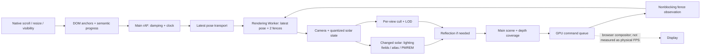
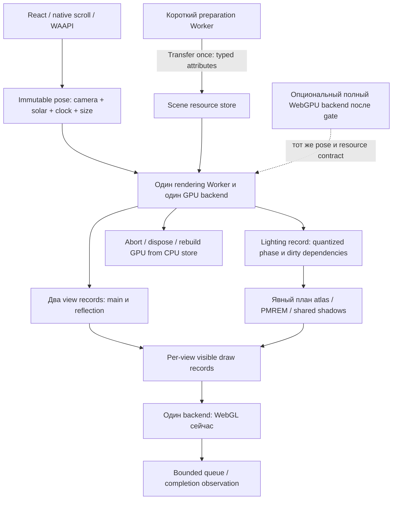
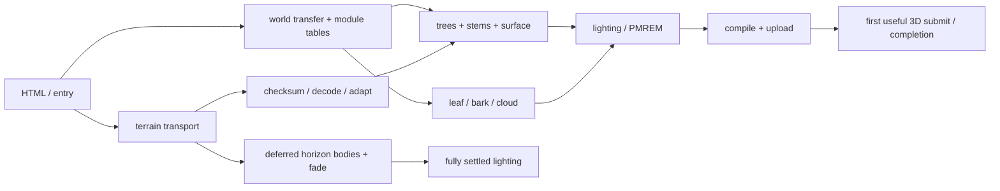

# C7 v645: архитектурное решение по производительности

> Поправка v646,08.11.2026: прежний flat diagnostic убирал alpha-test и reflection clipping; linker мог также удалять vertex varyings. Его47,7% нельзя считать чистой долей fragment shader, и прежний shader-only расчёт Амдала отозван. Исторические числа сохранены, рабочий646неunlit. [Проверка и исправление](/Users/maxkost/volnami/design/c7-v646-shading-result-2026-11-08.md). Разница31,35/41,90необъяснена одной сменой входного механизма; используются свежие согласованные сравнения.

08.11.2026. Исследовательский этап, без изменения рабочей версии, публикации, push, commit и субагентов. Все браузеры headless. Эталон v641, рабочая v645 и исходная незакоммиченная работа сохранены. Числа и исходные данные: [summary.json](../evidence/c7-architecture-v645-2026-11-08/summary.json). Прототипы: [папка исследования](../research/c7-architecture-v645-2026-11-08/).

## Решение

**Основной путь — сохранить React/Next, Three.js 0.186/WebGL2 и существующего Worker владельцем GPU; перерабатывать организацию освещения и шейдинга холмов/деревьев, выделив явные данные сцены и план проходов.** Для загрузки отдельно применять короткоживущий Worker подготовки растительности: его польза подтверждена на полном сайте. Не переносить основной сайт на Rust/C++, не заменять движок и не добавлять WebGPU как вычислительный придаток WebGL.

**Запасной путь — цельный WebGPU/TSL backend в том же rendering Worker**, с исходной v645 как отдельным WebGL fallback. Переход оправдан только после вертикального прототипа настоящего освещения ground + crown + отражения, с теми же MSAA, текстурами и разрешением. Изолированный compute быстрее, но не доказывает ускорения такого backend. Решения о полной миграции сейчас нет.

Крупный резерв найден в совокупности fragment shading поверхности и деревьев. В тройном сравнении **одних и тех же 180 поз** упрощение только этих двух семейств fragment shaders увеличило completion throughput **31,35 → 59,90/с**. Геометрия, ветер, камеры, размеры буферов и проходы сохранились, но изображение стало плоским: это **диагностический предел исследованной реализации, не допустимое продуктовое улучшение**. Переписывание culling на C++/WASM не ускорило полный кадр. Полное отключение вычисления near-grass ветра тоже не ускорило пролёт.

**+75–100% относительно v641 с сохранённым изображением не доказаны.** Для +75% требуется примерно втрое ускорить работу, которую устранила совокупная диагностическая подмена шейдеров; для +100% — примерно в 6,6 раза, при допущениях модели ниже. Возможность такого изменения ещё надо доказать реальным материалом. Ни аппаратный запрет, ни гарантированная достижимость не установлены.

## 1. Что действительно запущено

- React **19.1.1**, Next **15.5.29**, Three **0.186.0**, GSAP **3.15.1**, TypeScript **5.9.3**, Playwright **1.63.0**. R3F нет. Наличие GSAP в dependencies не означает, что текущие wave reveals выполняет GSAP: `wave-reveal.tsx` использует WAAPI + IntersectionObserver.
- Авторские модули: `lab/c7-scene/`. UI: `app/c7/`. Реальные URL UI, early worker и main-thread fallback указывают на **`/3d/c7/runtime-v645/`**. Старые `app/c7/scene/world.ts`, geometry-worker и связанные исторические модули не являются источником опубликованного C7 runtime.
- `scripts/c7-bundle-world.mjs:9` уже собирает production ES2022 module, tree shaking, concatenation и Terser passes=2. Нельзя объяснять проблему просто отсутствием минификации/tree shaking.
- Runtime world — **911 396 B decoded**; в измеренной передаче Brotli около **243 387 B**. Фактическая загрузка всего сайта больше; это разные величины.
- Рабочий переносимый пакет: `artifacts/c7-preview-2026-11-08-v645-local`, 110 файлов. Локальный просмотр: http://127.0.0.1:3210/c7/ . Публичная ссылка в этом исследовании не обновлялась.
- В `early-worker.ts` и принимающем `render-worker.ts` совпадает старый идентификатор **v643**, хотя URL уже v645. Поэтому утверждение «prewarm всегда выбрасывается» неверно. Это слабая идентификация версии, которую следует заменить digest/точной версией при будущей интеграции; доказанного текущего двойного запуска из-за неё нет.

Исходное состояние зафиксировано в `preservation.json`: 396 SHA файлов, HEAD и SHA исходного tracked diff. В него входят оба полных пакета, все `lab/c7-scene` и `app/c7`, package manifests и сборочные скрипты. Дополнительная финальная проверка опубликованных runtime приведена в `preservation-final.json`.

## 2. Карта системы и движение данных

| Подсистема | Реальные файлы / функции | Владение и связь |
|---|---|---|
| HTML и ранний старт | `app/c7/page.tsx:34`, `scene/early-worker.ts:4` | Prefetch entry/world, один early Worker до hydration; `take()` передаёт владение клиенту |
| Scroll, clock, UI | `landscape.tsx:18`, `frame`, `onScroll`, `resize`, `onVisibility` | DOM/main thread; кеш позиций секций; пассивный scroll; damping, ambient clock; React state меняется при смене loading/ready/fallback, не для каждого кадра |
| Транспорт | `scene/render-worker.ts:8`, `flush`, `onmessage` | Одна отправка до receipt + одна последняя pending pose. Transfer canvas один раз. Небольшие числовые сообщения, без передачи всей сцены |
| GPU admission | `lab/c7-scene/worker-entry.js`, `pump`, `observeCompleted` | Worker держит последнюю позу и максимум два fence; опрос 4 мс только при ожидающей позе; `frame` сообщает submit, не показ на дисплее |
| Fallback | `scene/shared-world.ts:26,83` | Тот же world на main thread при недоступном worker canvas; аналогичная очередь и неблокирующие fences |
| Сцена и кадр | `world.js:68,294,336,419,444` | `createC7Scene`, `setLight`, `setCamera`, `draw`, `renderState`; один владелец камеры, материалов и ресурсов |
| Terrain | `terrain-cache.js:66`, `adaptive-terrain.js:60,81`, `terrain-chunks.js:5` | Проверенные integer payload → regular mesh → adaptive indices и точный triangle sampler; плитки основного/depth проходов; исходный index для native caster |
| Near meadow | `grass.js:269,492,540`, `grass-static.js:6` | 1 215 418 stems, 3 071 пространственный bin, общий материал; mesh на bin, instanced attributes, две топологии. Culling/count/LOD отдельно для каждого глаза |
| Far meadow | `far-grass.js:305,370` | 74 830 stems, 110 patches, 3 292 520 B instance attributes. Native mesh-frustum culling и shader coverage. **Собственного `userData.update` у far-grass нет**; optional вызов в world ничего не делает |
| Деревья | `trees.js:189,222,897`, `tree-runtime.js`, ez-tree vendor | 13 уникальных процедурных деревьев; bark/leaves; per-crown параметры, terrain rays и 3×3 solar field; текущая геометрия не является миллионом Object3D |
| Свет / visibility | `sky-light.js`, `rear-fill.js`, `sky-horizon.js:134,210,320`, `sky-tree-atlas.js:13,48,82` | Sun + 3 sky directional, 3 rear spot; поля terrain horizon, owner mask, PCSS tree atlas, отдельные native maps |
| Материалы | `materials.js:216`, `grass.js:181`, `trees.js`, `fused-ground-sky.js`, `static-shadow-receiver.js`, `microcanopy.js`, `aerial.js` | MeshPhysical и цепочки onBeforeCompile / ShaderChunk; собственные surface/canopy BRDF, transmission/volume, shadow visibility и aerial |
| Вода и среда | `lake.js`, `sky.js`, `world.js:setLight/draw`, `pmrem-sample-cache.js` | Planar reflection, wave shader, sky quadrature; PMREM из того же неба; cached invariant sample math |
| Доставка / lifecycle | `startup-inputs.js:6`, `binary-transfer.js:16,40`, `canvas-platform.js`, `world.js:75` | Single-consumer input ownership, abort; lossless transport/decode; retained CPU attributes для context restore; dispose ресурсов, обработчиков и worker |
| DOM-анимации | `wave-reveal.tsx:8`, `testimonials.tsx`, `chrome.tsx` | WAAPI transforms/opacity, observer entries/re-entry, cleanup. Отдельны от WebGL world |



Порядок кадра: обновить camera при движении → квантовать solar в 1/256 → при изменении solar обновить свет, fit shadow cameras, tree atlas, leaf visibility и PMREM → применить horizon fade → проверить water occlusion → при необходимости reflected scene → main scene. Перед сборкой списка каждого глаза `scene.onBeforeRender` обновляет depth coverage и near culling/LOD. Разные глаза требуют разных count/LOD: простое повторное использование списка основного глаза удалит нужную траву из отражения.

**Проходы уже частично переиспользуются.** Native `renderer.shadowMap.autoUpdate=false`; `setLight` выставляет needsUpdate. Первое scene render с потребностью обновляет общие карты, второе использует их. Rear maps уже заморожены до invalidate. Трава не castShadow. Отражение при camera/light changes обновляется на scroll-кадре; в idle есть eligibility по clock >0,1 с и дополнительный cap 30 Гц. Его нельзя просто заморозить без изменения отражённого берега/ветра.

Нет EffectComposer/fullscreen post chain. Дополнительная работа здесь — sky/PMREM, atlas, native shadows, planar reflection и depth coverage, а не универсальный bloom/DOF-пакет.

## 3. Стенд, актуальность прежних чисел и пределы измерения

Apple M3 Pro, 11 logical CPU, 18 GiB, macOS 26.7.1 arm64. Chrome **156.0.8078.80**, ANGLE Metal. AC 100%, thermal/performance warnings не обнаружены. Температура и частоты GPU недоступны. Пользовательские приложения не закрывались. Idle driver counter показывал 42–44%, но источник/актуальность счётчика не установлены: **это не доказанная внешняя GPU-загрузка и не объяснение аппаратного предела**.

Production static exports, loopback server с заранее сжатыми текстовыми ресурсами, обычный cache. Основной render-тест: 2560×900 CSS, DPR=1,5, **3840×1350 drawing buffer**, без network/CPU throttle, warm full-route 2 с, sample 10 с, свежий Chrome на прогон, AB/BA/AB. Timer120 подаёт `.05→.87→.05` с тем же solarForTravel. GPU-прогоны последовательны. Контроль fixed180 отправляет и дожидается **всех 180 одинаковых поз**, clock=`10+i/60`, с той же очередью 2. Это отдельный сценарий, числа двух стендов не смешиваются.

| Текущий повтор, медиана [min–max], 3 прогона | v641 /с | v645 /с | Изменение | p95 интервала submit, мс |
|---|---:|---:|---:|---:|
| 2560 timer120, полный пролёт | 25,88 [25,82–25,96] | 31,13 [30,92–31,38] | +20,29% | 45,9 → 40,0 |
| Те же 180 поз, все завершены | 25,99 [25,62–26,08] | 30,94 [30,94–31,09] | +19,07% | 48,5 → 41,9 |

Прежние **34,38→41,90/с абсолютные значения не воспроизвелись**. Сохранился близкий относительный эффект. Старые 1440 transition / 390 / полный DOM route / 4Mbps из отчёта v645 остаются историческими измерениями с указанными там условиями; они не выданы за новые A/B. Новые mobile/desktop load comparisons приведены ниже.

Что измерено:

- rAF — планирование ввода/DOM; GPU submit — отправка; fence — обнаруженное завершение команд. **Физический display FPS, реальные display drops и field INP не измерены.** p95/проценты >25,2 мс — интервалы submit, не presentation timestamps.
- CPU вокруг render — JS + driver enqueue, не GPU time. CPU/GPU могут перекрываться. CPU trace и отключения использованы совместно; отсутствие long tasks отдельно ничего не доказывает.
- Опрос `clientWaitSync(...,0,0)` не блокирует каждый кадр. Нет gl.finish, await GPU на каждом продуктовом кадре. Drain/readback в сравнении PNG, prototype kernel и fixed-проверке ограничен диагностикой.
- Прежняя калибровка overhead измерителя ~0,3–1% и его rAF ceiling ~60/с изучены; новый основной timer120 не упирается в этот rAF ceiling. Пограничные 2 outstanding completion за 10 с дают до 0,2/с погрешности, учтены повторениями.
- EXT_disjoint_timer_query поддержан; **disjoint=0 недостаточно, чтобы считать интервалы exclusive GPU time**. При 681 ненестед CPU-вызове render сумма elapsed ranges составила **1807,09 мс на 700,80 мс fenced wall interval**. Эти интервалы не могут делить кадр на аддитивные доли. `gpu-timer-validity.json`; сами query ranges сохранены, но из них не рассчитан процент bottleneck. CPU scope report отдельно сделан без queries.
- В WebGPU compute использованы поддержанные timestamp-query и 60 dispatches на range, асинхронный readback после batch. По официальной документации Chrome timestamp precision ограничивается; защитные flags не менялись. Поэтому приведены округлённые batch/range результаты и host wall control, без нан osecond-точности. [Chrome timestamp queries](https://developer.chrome.com/docs/web-platform/webgpu/developer-features).

## 4. Подтверждённые расходы

### Контролируемые факторы полного кадра

Экранный диагностический screen — по одному прогону между контролями, для ранжирования. Это временные изменения качества, не принятый код. Контроли 31,17–31,35/с.

| Изменён ровно один фактор | Completion /с | CPU p50, мс | Вывод |
|---|---:|---:|---|
| Flat near-grass fragment shader | 33,87 | 9,4 | Near fragment work имеет вклад; оно не объясняет весь бюджет |
| Flat ground fragment shader | 43,60 | 8,7 | Крупная цена shading холмов, при сохранённой геометрии и render passes |
| Flat tree fragment shaders | 42,12 | 8,7 | Крупный связанный вклад crown/bark/leaf shading |
| Выключено обновление reflection | 40,28 | 6,7 | Повторная сцена заметно дорога; удаление эффекта недопустимо |
| Near grass не рисуется | 35,56 | 8,2 | Снято и CPU submission, и GPU work в двух глазах; это не чистое vertex time |
| Без native shadows + соответствующего native shader shadow пути | 41,26 | 7,8 | Тени дороги; atlas/horizon при этом не выключены |
| Native карты frozen | 34,94 | 8,6 | Обновление карт — только часть общей стоимости теней |
| Без tree-shadow shader lookup | 32,79 | 9,3 | Отдельное PCSS-поле не объясняет крупный выигрыш flat ground |
| Без horizon shader lookup | 32,05 | 9,8 | Одно поле не является единственным bottleneck |
| DPR1 вместо 1,5, **только диагностика** | 35,04 | 9,1 | Drawing buffer2560×900 вместо 3840×1350; +~12%, несмотря на −56% main pixels: много стоимости в fixed targets/другой работе |

Первый ошибочный dpr1 screen не изменил drawing buffer: он явно исключён в `experiment-notes.md`, повтор с проверенным буфером — `render-factors-extra.json`. Старые repeated/no-gain эксперименты из v645 перечитаны; их выводы не переписаны новым названием.

Главные shader-выводы дополнительно проверены **3×180 одинаковых поз**, каждый кадр принят и завершён:

| Материалы | Completion /с, медиана [min–max] | p95 submit, мс | Маргинальное сокращение reciprocal turnaround относительно контроля |
|---|---:|---:|---:|
| Штатные | 31,35 [31,06–31,50] | 40,3 | — |
| Только ground flat | 43,14 [43,09–43,92] | 30,8 | ~27,3% |
| Только trees flat | 41,22 [41,12–41,24] | 31,4 | ~23,9% |
| Оба flat | 59,90 [59,86–60,86] | 21,5 | ~47,7% |

Это **не exclusive GPU доли**. Сохранены vertex programs, геометрия, grass animation, световые/отражённые проходы; заменены fragment programs соответствующих групп. Часть native shadow sampling и canopy/BRDF исчезает одновременно, GPU scheduling меняется. 27,3+23,9 нельзя складывать; совместный опыт дан отдельно. Timer-опыт обоих flat дал 70,85/с, но его accepted pose/light-cache последовательность отличалась; для модели выбран более строгий fixed180 результат 59,90.

### CPU, команды и память

Worker CPU profile 8 с: idle **5066 мс (~63%)**; self samples vertex-attribute setup ~717 мс, другой setup~98 мс, adaptive height query~287 мс, terrain ray~114 мс, matrix world~205 мс, render-list traversal~196 мс, near cull~111 мс, sort~43 мс. Это sampled self time, не аддитивные GPU проценты и не одновременный точный таймер всех функций. Minified offsets и source excerpts сохранены в `cpu-profile.json`, полный `worker.cpuprofile`.

Query-free per-pose diagnostic (после первого круга), суммы CPU scopes на полный кадр: near cull/LOD **0,4 [0,2–0,5] мс**, scene matrices **1,2 [0,5–1,6]**, native shadow CPU **0,5 [0,4–0,7]**, leaf lighting CPU **1,0 [0–3,5]**. Диапазоны зависят от позы; scopes вложены в renderer и не складываются с full render CPU. Far-grass update отсутствует, ему не приписана стоимость.

Репрезентативный q=.78: **93 environment +669 reflection incl shadows +1211 main=1973 logical draws**, **8,165 млн submitted triangles** за полный кадр. В шести выбранных позах 7,10–8,17 млн triangles. В прогретом flight счётчик около 1500 calls/кадр. Это submit counts всех проходов, не число уникальных моделей и не мегапиксели. Сцена после init содержит 3797 Object3D,3763 meshes,33 уникальных materials; после прогрева 25 programs,44 textures,1617 uploaded geometries. Счётчики ресурсов не названы байтами.

Первое посещение шести поз загрузило **29,77 МБ bufferData array payload**; следующие круги не обновляли эти геометрические buffers. На solar field uploads остаётся около **50,6 КБ/кадр** в этом диагностическом маршруте. `pass-profile-cpu.json`. Это аргумент для измеренной фоновой подготовки впервые видимых buffers и явной GPU-residency таблицы, но не для ежекадрового WASM→GPU перепаковывания. Ранний upload всех buffers может увеличить startup/peak memory; нужен отдельный p95 опыт, он не объявлен бесплатным улучшением.

Четыре 4096² directional и три 2048² rear native targets на desktop — существенный fixed footprint. Из текущих R8 color + uint depth форматов получается **номинально около 380 MiB** только для этих attachments при 4B/depth texel. Это расчёт форматов, **не измеренный VRAM/RSS**; driver padding, aliasing и фактическая residency неизвестны. WebGPU не уберёт размер карт при сохранённых эффектах автоматически. Уже испытанный native depth-only WebGL вариант дал около 1%, потому он не принят. Reflection —1280×720 RGBA16F с поддержанным 4×MSAA и mip chain, ещё отдельная память/bandwidth.

Реальный `/c7/`, 12 с вниз/вверх, Chrome trace: main TaskDuration578 мс, Script108 мс, Layout17 мс, RecalcStyle197 мс, long tasks0, console/page errors0. Scopes вложены, их нельзя суммировать. Это поддерживает вывод, что React/DOM не главный источник данного wide-flight ограничения; **не доказывает отсутствия всех main-thread проблем**. След однократного роста heap/DOM после reveal не является доказательством утечки или её отсутствия. Полный trace `actual-trace.json.gz` и summary. Предыдущие 5-cycle memory/lifecycle данные v645 изучены; новые подтверждения helper lifecycle ниже. Полные GPU bytes/долгий нагрев заново не измерены.

## 5. Три сравнительных прототипа

### P1. Точный data-oriented culling: JS objects / SoA JS / C++ WASM

Гипотеза: убрать тысячи JS-переходов через объекты и ускорить тест 3071 bins и ranked density search. Настоящий полный world, те же F64 planes/bounds и Float32 ranks, один batch call на глаз. Результаты возвращаются в те же Mesh/LOD. Без fast-math; `-ffp-contract=off`.

| Вариант, 3 прогона | Completion /с [min–max] | p95 submit, мс |
|---|---:|---:|
| Исходный object JS | 31,35 [30,86–31,36] | 40,0 |
| Batch SoA JS | 31,08 [31,03–31,28] | 40,3 |
| Batch C++/WASM | 31,08 [30,94–31,46] | 40,2 |

Нет подтверждённого full-frame ускорения. Culling CPU иногда уменьшается с 0,2 до 0,1 мс/глаз, при timer resolution0,1 мс это не точный микробенчмарк. На 42 кадрах (390/1440/2560,7 wind/solar/back poses ×2 варианта) **max RGBA diff0**, visibility/count/LOD mismatches0, GL0.

Граница WASM: один раз копируются 12F64/bin и 1,215M F32 ranks; каждый глаз записываются 192B planes+24B camera, затем JS читает 36 852B output из общей linear-memory view и присваивает visible/count/LOD. Это JS/WASM общая память одного Worker, **не SharedArrayBuffer между потоками**. Linear memory8MiB, код~1,6KiB, существующие JS атрибуты дополнительно остаются. Выигрыш ядра не перекрывает/не меняет GPU work и применение результатов.

Код: `cull.cpp`, `culling-prototype.mjs`, `culling-test.mjs`; C и C++ дали byte-identical WASM. Вывод: **не интегрировать эту замену ради FPS**. Instancing уже есть; culling на каждую травинку здесь не выполняется.

### P2. Короткоживущий Worker генерации травы

Гипотеза: выполнять тот же детерминированный `createGrassAsync` параллельно созданию trees, вернуть typed attributes через transfer, а все GPU resources создавать только rendering Worker. В изолированном `parallel-scene` открыт точный adaptive sampler; математические функции и RNG не переписаны. Переданный sampler пересобирает тот же triangle lookup. Изменённые только для research source checksums перебинжены с прежними binary field bytes (`parallel-research-rebinding.json`); fallback на serial не засчитан за успешный parallel run.

**Обычный HTTP production export, без перехвата entry/module, 3 пары AB/BA/AB:**

| Профиль/cache | Control ready, мс [min–max] | Parallel ready, мс [min–max] | Сокращение |
|---|---:|---:|---:|
| 1440, loopback cold | 2577 [2577–2583] | 2210 [2194–2219] | 367 мс,14,3% |
| 1440, loopback warm | 2467 [2465–2508] | 2143 [2112–2173] | 324 мс,13,1% |
| 390,4Mbps/100ms cold | 5221 [5196–5262] | 5060 [5058–5076] | 161 мс,3,1% |
| 390,4Mbps/100ms warm | 1886 [1884–1889] | 1755 [1754–1763] | 131 мс,7,0% |

Ready — штатное состояние world/DOM после первого submit, не раннее скрытие loader и не physical presentation. Helper timing подтверждает реальную работу. Первичная передача выросла всего на 2365B: desktop3 402 468→3 404 833B, mobile2 693 434→2 695 799B; повторно 0B. World module code запрашивается вторым worker, но HTTP cache/coalescing в данном стенде не дал второго полного body.

Издержки: **21 753 880 B sampler clone**, postMessage около 4–5 мс; **53 478 392 B desktop /10 012 068 B mobile** выходных ArrayBuffers передаются с передачей владения. Отправитель не сохраняет их; rendering worker восстанавливает geometry примерно 11–14 мс. Наблюдаемая доставка около 30–33 мс включает scheduling/очередь, а не только копирование. Второй module evaluation ещё~550 мс, обычно перекрыт warmup. Известные дополнительные CPU buffers во время handoff — порядка 75 МБ desktop /32 МБ mobile плюс объекты/module state: **это оценка transient ownership, не измеренный пик RSS**. Нужен контроль memory pressure на настоящем телефоне.

Full wide frame: control **31,37 [31,15–31,45]**, parallel **31,16 [30,98–31,55] /с**, p95~40 мс обоих. **FPS-ускорения нет**, и оно не ожидалось от startup helper.

На 21 кадре 390/1440/2560 max RGBA diff0, GL0. Три реальных case/back цикла:1render worker активен,0away,1 после возврата; helper после handoff отсутствует. Ранний уход 0workers. Принудительный отказ helper — штатный serial fallback, затем 0workers после ухода. Firefox155 и Playwright WebKit26.6: actual worker backend + непустой researchParallel, ready/overflow/errors проверены; это functional smoke, не нативный Safari и не speed benchmark этих браузеров.

Вывод: **принимать архитектурную границу CPU preparation / GPU owner**, а сам прототип ещё требует интеграционной доводки: узкий helper bundle вместо импорта всего world, верхняя граница memory pressure, timeout/abort, release identity. Рабочая v645 не заменена.

### P3. Реальный grass wind: GL transform feedback / WebGPU storage compute / bridge

367 421 видимый stem из настоящей q=.78 сцены, Float32 root.xz и shape.w. Точно те же формулы field noise/gust/flutter; input5 878 736B, output2 939 368B. Три чередования GL/GPU,60 invocations-batches, отдельные прочтения после измерения. Это resident compute kernel, **не WebGPURenderer и не full-site WebGPU prototype**.

| Наблюдение | WebGL TF | WebGPU WGSL |
|---|---:|---:|
| GPU elapsed range / invocation, медиана [min–max], мс | 0,175 [0,167–0,183] | 0,054 [0,049–0,064] |
| Host wall на batch60, мс | 13,6 [12,1–14,7] | 3,7 [3,4–5,2] |

Range проверен сравнением с host batch wall; нет переноса per-pass query sums из предыдущего раздела. Queue/readback задержки входят в wall; это не точный одиночный GPU service time. Более быстрый compute не означает такой же коэффициент для lighting fragment shader. CPU enqueue местами ниже timer resolution, поэтому 0 в сырых данных не означает нулевую стоимость.

Gust совпал точно; flutter max diff7,64e−8. Это проверка чисел на данном Apple/Metal, **не pixel parity полного WebGPU изображения и не обещание одинакового sin на всех GPU**. WebGPU validation errors0, GL0.

Bridge WebGPU→CPU readback→copy→WebGL upload для 2,94 МБ: **4,10 [3,70–4,60] мс** до обнаруженного завершения GL fence,10 повторов; map~0,8, copy~0,2, enqueue~0,1 мс, остаток включает queue/poll. Никакого стандартного общего WebGLBuffer/GPUBuffer этот код не использует. Нельзя вычесть этот sequential diagnostic latency из кадра механически, но он намного больше экономии tiny wind kernel.

**Полный кадр с нулевой ценой gust/flutter** (диагностические constants, без удаления stems): control31,36 [31,18–31,65], zero-wind31,38 [31,24–31,62]/с. Польза не подтверждена. Предыдущие per-patch TF и общий TF multi-draw также не выиграли. Вывод: **не внедрять compute sidecar и не делать wind главной причиной WebGPU migration**. В цельном будущем backend storage buffers могут быть полезны другим тяжёлым ядрам без readback; это ещё надо измерить.

## 6. Прямой ответ о языке

**Переписывание основной части на Rust/C++ не обосновано.** DOM/React, очереди, создание GPU pipeline и сами fragment shaders от этого быстрее не станут. TypeScript полезен для contracts/lifetime и рефакторинга, но типы стираются при компиляции; он не является другим быстрым runtime. [TypeScript](https://www.typescriptlang.org/docs/handbook/2/basic-types.html).

| Кандидат | Измеренная работа сейчас | Предел и стоимость переноса | Решение |
|---|---|---|---|
| Near cull/count/LOD | ~0,4 мс/полный кадр; actual prototype выше | Даже полное удаление даёт около 1% turnaround при 32 мс, если работа на critical path. Persistent memory, одноразовая копия ranks, tiny batch boundary, JS Mesh application остаётся | Оставить JS; выигрыш WASM полного кадра не найден |
| Canopy terrain rays / exact triangle sampler | CPU self~401 мс/8 с в profile, leaf scope median1 мс, max3,5 после warm | Верхняя wall доля около 5% в данном профиле, с перекрытием может быть меньше. Для WASM передать 21,75 МБ immutable sampler один раз; считать весь пакет лучей внутри, а не callbacks в JS на каждый heightAt; tiny field output | Вторичный кандидат после shader работы; сначала bounded exact phase cache/SoA в JS. Ни 3×WASM-ядро, ни+75% сайта не доказаны |
| Генерация near stems | Полный build~0,65–0,70 с desktop /0,25–0,28 с mobile helper | RNG, shore field, F64 triangle sampler и normal grids должны жить в одном модуле; 53/10 МБ output всё равно нужны GPU. Порт отдельных вызовов с JS callbacks сведёт выигрыш к нулю; нужна полная ownership-схема и численная валидация | Сначала доказанный JS helper. C++/Rust не нужен для этой границы потоков |
| Terrain module initialization | Самостоятельный browser probe~0,53 с, те же реальные формулы | SDF~31 мс, left rows~134 мс, green rows~79 мс, четыре solver loops **суммарно 116,8 [113,9–118,8]мс**; оставшееся — их начальные height queries/другие таблицы. Нельзя приписать все 0,53 с Rust solver | Порт только solver даже бесконечно быстрый уберёт максимум~0,117 с:~2,2%cold5,2 с /~4,7%warm2,47 с, до накладных расходов. Не главный приоритет |
| Terrain restore/adapt | Decode~0,09–0,11 с, adapt~0,12–0,14 с в marked startup | WASM может держать payload/indices в persistent memory, но Three BufferAttributes и normal sampling потребуют views/ownership; не ускорит сеть. Не все эти интервалы — арифметика | Сначала более ранняя доставка/подготовленный topology cache, затем профиль конкретного ядра |
| Fragment BRDF/shadows/reflection | Самый крупный подтверждённый совокупный резерв | Выполняется GPU; WASM не уменьшит pixels, taps, passes или shading | GLSL/TSL/данные GPU, а не Rust/C++ сайта |

`WebAssembly.Memory` позволяет JS typed views на linear buffer; это устраняет часть копий JS/WASM, но не GPU upload. При grow views нужно пересоздавать. Многопоточная shared memory добавляет требования isolation; обычный однопоточный WASM их не требует. [Memory API](https://developer.mozilla.org/en-US/docs/WebAssembly/Reference/JavaScript_interface/Memory).

Если впоследствии появится более тяжёлое batch CPU ядро, **C++ freestanding WASM уже проверен как инструмент**; Rust возможен с той же схемой данных, но Rust toolchain/benchmark здесь не запускались, преимуществ над C++ не заявлено. Поддержка двух языков, decoder/runtime bytes, symbols/source maps и восстановление ресурсов — дополнительная цена. Постоянная память должна принадлежать scene resource owner, а не утекать в глобальный cache.

## 7. Сравнение архитектур A–E

| Вариант | Механизм именно для C7 | Подтверждение / ожидаемый общий эффект | Объём, риски, совместимость, уверенность |
|---|---|---|---|
| Текущая v645 без переработки | Уже instancing, binning, worker, cached fields, frozen-on-change shadow/PMREM | Проверенный +19–20% к 641 на новом стенде; target остаётся открыт | Минимальный риск; известные visual/browser fallback. Высокая уверенность в текущем состоянии |
| **A. Three/WebGL, явные ресурсы/проходы и специализированный shading** | Уменьшать реальную работу ground+tree kernels и повторные вычисления для двух глаз; отделить неизменяемые geometry/lighting records от Object3D; один GPU owner | P1 исключил простой culling rewrite; fixed shading показал резерв совокупных материалов. **Число принятого quality-preserving render gain пока 0**: target для новой реализации надо доказать | 8–15 файлов для первого material/pass slice; сложность средняя/высокая. Максимально сохраняет текущий GLSL/браузеры. Основной путь по стоимости/риску; конкретный +75 не обещан |
| **B. Preparation Worker + нынешний OffscreenCanvas owner** | Перекрыть trees/stems CPU, передавать buffers один раз, helper закрыть; input/DOM остаются main | Полный startup −14%desktop/−3%mobile cold. После boot frame throughput не изменился | Прототип готов, 6 основных source-файлов; memory peak и duplicate module init. Высокая уверенность в стенде, мобильный GPU/pressure ещё не проверены |
| C. Точечный WASM | Batch numerical kernels и persistent data, без callbacks | Culling full-frame gain не найден; solver upper bound0,117 с startup. Большой port не уменьшит GPU cost | Дополнительные binary/toolchain/debug/lifetime, full migration дорого. Точечная совместимость широка, threads требуют headers. Высокая уверенность в NO_GO для whole-site rewrite |
| D. Цельный Three WebGPU/TSL | Native storage/instanced data вместо texture fetch, bundles/command reuse, compute тяжёлого lighting data; один backend без bridge | Реальный compute wind быстрее, full-frame wind benefit0. **Полный WebGPU renderer gain не измерен**. Для lighting/плана проходов потенциал есть, величина неизвестна | 15–25 семейств custom hooks/шейдерных подсистем требуют review/порт; AA/clip/depth/color parity, fallback, device loss. Высокая цена и средняя/низкая уверенность в целевом эффекте. Запасной, с обязательным vertical slice |
| E. Babylon/PlayCanvas | Другая реализация submission/material system/instances | C7 уже использует instancing; новый engine не уберёт сложный light transport. Репрезентативного full-site gain нет; до прототипа отклонён как дорогая смена без найденного уникального механизма | Перенос custom materials/atlas/reflection/camera/lifecycle. Babylon thin instances также имеют culling tradeoff. PlayCanvas WebGPU/compute не отменяет тот же shader port. Низкая уверенность в выгоде |
| E2. Небольшой собственный renderer | Убрать scene graph и generic state bookkeeping, хранить готовые draw records | Самые заметные measured CPU self setup/матрицы/обходы — часть workerwall, который в основном idle. Нет доказательства, что удаление Three меняет GPU shading | Придётся самим поддерживать shaders/cache/shadows/restore/browser quirks. Допустим узкий internal draw subsystem при новом proof, не весь renderer сейчас |

Babylon официально описывает thin instances и их all-or-nothing group culling; нынешние 5 м bins нельзя заменить одним огромным mesh без проверки лишних видимых stems. [Babylon thin instances](https://doc.babylonjs.com/features/featuresDeepDive/mesh/copies/thinInstances). PlayCanvas предлагает WebGL/WebGPU и свои passes/instancing/compute, но эти возможности сами по себе не являются C7 benchmark. [PlayCanvas graphics](https://developer.playcanvas.com/user-manual/graphics/).

Почему старые batching/wind варианты не доказывают бесполезность подхода:

- Texture-backed multi-draw уменьшал CPU calls ценой четырёх texelFetch/stem/vertex и индексации через drawID. Это **другая стоимость данных**, а не чистое снятие API overhead. Более крупные 10/20 м clusters ухудшали culling; сохранение количества calls не равно сохранению работы GPU.
- Per-patch TF добавлял много barriers; общий TF multi-draw всё равно добавлял dispatch/write/read проход. Новый WGSL-прототип подтвердил, что даже быстрый wind не является нужным bottleneck. Это вывод о wind, не запрет на compute для дорогого visibility/lighting.
- В WebGPU можно хранить native instance/storage buffers и indirect records без texture-backed эмуляции. Но culling<~1%wall сам по себе не оправдывает этот порт; нужна выигравшая организация **более дорогого shading**.
- Старые MRT/preblend fields добавляли bandwidth/pass и не выиграли. Не повторять их под другим именем. Новый вариант обязан обосновать конкретный reuse, размер/bandwidth и положительное whole-frame A/B.

### Worker и WebGPU совместимость

Canvas уже перенесён в Worker; переносить его повторно нельзя. Ordinary transferable ArrayBuffer передаёт владение и отсоединяется у отправителя, SAB для прототипа не понадобился. Для SAB понадобятся secure context + COOP/COEP и проверка сторонних ресурсов; текущий сайт crossOriginIsolated=false. Менять заголовки ради tiny pose messages не требуется. [Transferable objects](https://developer.mozilla.org/en-US/docs/Web/API/Web_Workers_API/Transferable_objects), [crossOriginIsolated](https://developer.mozilla.org/en-US/docs/Web/API/Window/crossOriginIsolated).

Актуальная документация Three прямо требует переноса ShaderMaterial/RawShaderMaterial/onBeforeCompile на node materials; это не смена одной строки renderer. TSL может выдавать WGSL и GLSL, renderer имеет WebGL2 fallback, но сам по себе не гарантирует лучшую скорость. [Three migration guide](https://threejs.org/manual/pages/webgpurenderer). При native fallback compute не всегда равнозначен WebGPU: локальный r186 `webgl-fallback` содержит TF/PBO emulation, `storageBuffer:false`, ограничения indirect count; проверять реальные используемые nodes и не обещать одинаковый compute path.

Нужно портировать turf surface/canopy + fused sky/tree visibility; near/far deformation и coverage; leaf PBR/HG/volume/finite disk; sky/clouds/PMREM sample cache; tree PCSS/owner atlas; aerial/microcanopy/rear masks; water quadrature/projective reflection/clip; depth coverage/static receiver; native shadow specialization. MSAA должен быть явно включён: у WebGPURenderer antialias default=false, текущий продукт true. Сохранить 4samples, color space/ACES/exposure, HDR targets, alpha-test/mips, UV/Y/depth conventions. [WebGPURenderer options](https://threejs.org/docs/pages/WebGPURenderer.html).

WebGPU проверен здесь только на Chrome/Apple Metal3 с timestamp-query. Официально Chrome поддерживает определённые desktop/Android платформы, Firefox147 включил Apple Silicon macOS; у Safari WebGPU связан также с версией ОС — например Safari26 на старой macOS не равен WebGPU на Tahoe/iOS26. Feature detect/requestAdapter/device creation + failure recovery обязательны, fallback нужен. [Chrome status](https://developer.chrome.com/docs/web-platform/webgpu/overview), [Firefox147](https://www.firefox.com/en-US/firefox/147.0/releasenotes/), [WebKit OS requirement](https://bugs.webkit.org/show_bug.cgi?format=multiple&id=299237). Документационная совместимость не выдана за замеры физических устройств.

## 8. Целевые данные и организация работы



Практическая целевая структура, без механической замены всех Object3D:

1. **SceneResourceStore:** immutable typed arrays, textures и logical IDs с одним owner; раздельно CPU retained / GPU residency / construction temporary. Удаление временных Sampler clones и worker на handoff/abort. Release поздно пришедших images. Для device/context restore держать ровно необходимые CPU arrays, не вторую полную копию сцен.
2. **ViewRecord[2]:** camera matrices, viewport, clip plane, near visible bins/LOD/count; distinct списки main/reflected, общий набор immutable buffers. Кешировать только неизменившийся результат; time-dependent geometry/solar masks учитываются явным key. Far bins оставить native conservative culling, пока иной вариант не выиграл.
3. **LightingRecord:** source directions/colors, solar generation, cloud/environment generation, terrain/tree-field generation. Нативные карты, atlas и PMREM имеют разные dependencies. Текущий solar-grid preserved. Генерации должны исключать дублирование, **а не пропускать нужные solar/cloud обновления**. В v645 карты уже shared: приёмка нового графа не может приписать себе существующий reuse.
4. **Материалы как проверяемые функции:** разобрать собранные ground/crown fragment programs на source visibility, surface BRDF, canopy/transmission и atmosphere; явные inputs/outputs вместо многочисленных string patches и зависимостей от приватного r186 chunk. Упростить хранение/передачу и повторное вычисление одинаковых значений, сохранить активную математику. Простое переименование hooks/ShaderMaterial без уменьшения работы не засчитывать. Сравнивать сначала ground+crown в main+reflection; если выигрыш отсутствует, остановить этот вариант.
5. **Draw records/native attribute binding:** единые неизменяемые attribute slabs по material/LOD, отдельные пространственные bins. Не вводить гигантский mesh, не подавать texture-backed stems, уже показавшие регрессию. Buffer residency/preupload тестировать отдельно от culling и отдельно от startup. На WebGL сохранить нынешний путь как fallback при отсутствии нужных extensions; при WebGPU использовать native buffer offsets/storage и не читать каждый кадр их обратно на CPU.
6. **Preparation boundary:** узкий helper bundle с generator/sampler без всей world/renderer части; параллелить с trees только при наличии memory headroom. Оптимизировать duplicate top-level terrain evaluation: immutable analytical tables загружать/восстанавливать по source digest, авторские fallback generators подключать по необходимости. Кеш не должен увеличивать cold critical bytes сильнее экономии CPU.

Ни один пункт о новом rendering graph не назван уже достигнутым ускорением. P2 — доказанный механизм startup; P1/P3 — доказанные причины не тратить миграционный бюджет на неверные горячие точки.

## 9. Расчёт достижимости

В matched fixed180 текущая v645≈**1,1907×v641**. Нужно ещё 1,4698× для общего 1,75 и 1,6797×для общего 2,0, то есть сократить turnaround новой версии примерно **32,0% /40,5%**. На timer120 относительная база 1,2029, ориентиры этой метрики 45,28–51,75/с; переносить ночные 60,3–68,9 на нынешнее окружение нельзя.

Для sensitivity model принимаем `f=1−31,3485/59,9002≈0,4767`: маргинальная часть, которую убрал совместный flat-fragment опыт. Это **proxy**, не измеренная exclusive доля GPU. Другая архитектура может менять overlap/caches и bottleneck; закон Амдала здесь показывает требования к решению, а не предсказывает FPS.

`S645 = 1 / ((1−f) + f/k + overhead)`; `S641≈1,1907 × S645`.

| Сценарий, условный k для совокупной работы | Дополнительное ускорение к 645, без новых расходов | Всего к 641 | Статус основания |
|---|---:|---:|---|
| Консервативный k=1,2 | 1,086× | 1,293× (+29%) | Небольшая локальная экономия, пока не измерена новым материалом |
| Средний sensitivity k=2 | 1,313× | 1,563× (+56%) | Даже двухкратное ускорение целевой совокупности не даёт+75% сайта |
| Оптимистичный k=4 | 1,556× | 1,853× (+85%) | Нужна крупная реорганизация shading с проверкой качества; не подтверждено |

Для+75% модель требует k≈**3,04**, для+100%k≈**6,62**, без интеграционных расходов. Добавленные compute/bandwidth/passes увеличат требования. Простое ускорение всего CPU-кода в 2 раза не имеет таких оснований: основной поток занят мало, worker часто idle, и критический GPU shader work остаётся.

Достижимость+75% **не исключена** diagnostic ceiling; **не подтверждена** quality-preserving prototype. Достижимость+100% ещё менее уверенная. Нельзя объявить предел аппаратуры по этим данным. Нужен профиль/whole-frame benchmark нового lighting kernel, а для физической плавности — presentation/реальные устройства.

## 10. Архитектура загрузки и <4 секунд

Marked production diagnostic, обычный HTTP,390/4Mbps down,100ms latency,CPU1. Это один timeline, а не новый median каждого этапа. В отдельном uninstrumented3-pair тесте control ready5,221 с.

| Момент от navigation | Cold mobile | Warm mobile | Что происходит |
|---|---:|---:|---|
| Worker entry | 0,710 с | 0,141 с | Ранний entry/module старт всё ещё ждёт доставку bootstrap/HTML |
| world request / evaluated | 0,719 /2,648 с | 0,162 /0,712 с | Transfer world заканчивается~2,078 с; после него ещё~0,57 с модульных расчётов |
| Terrain decoded / adaptive ready | 4,165 /4,304 с | 0,816 /0,935 с | Body terrain719→4057 мс,841092B; restore/adapt отдельно |
| Trees start / done | 4,327 /4,554 с | 1,018 /1,241 с | Процедурные crowns и CPU data |
| Grass generated / static GPU prepared | 4,805 /4,828 с | 1,488 /1,513 с | В control serial после trees |
| Textures ready | 4,948 с | 1,636 с | Leaf body2,658→3,989 с; не блокирует конец terrain |
| Initial light/PMREM done | 4,987 с | 1,671 с | Первый lighting setup |
| Programs await done / first submit done | 5,078 /5,203 с | 1,786 /1,892 с | Компиляция, uploads, первый совмещённый render |
| First completion observed | 5,223 с | 1,915 с | Fence observation, не физический показ |

Horizon bodies стартуют после terrain~4,060 с: left заканчивается~5,254, sky~5,758. Их fade может закончиться **позже ready**. Это штатная progressive модель v645, не «сцена полностью закончилась в 5,2 с». Ускорение loader не принималось за ускорение GPU.



Все 2,69 МБ нельзя объявить критическими до первого кадра: часть horizon приходит после ready. Также неверно назвать весь decode GPU upload или обещать ready4 с одним удалением 100 КБ.

Что следует делать с загрузкой:

1. **Ранний старт critical terrain/entry**, согласованный с выбором transport, без двойного br/zstd/gzip. В текущем холодном trace первые 719 мс до terrain request потеряны; это измеренный запас до~0,6 с, **не гарантированная экономия**, потому ранние запросы конкурируют с world/HTML. Вынести actual transport bootstrap/preload в earliest delivery и проверить обычный cache/network. Не поднимать приоритет всех assets сразу.
2. **Узкий preparation helper**, уже проверенный: −0,16 с mobilecold /−0,37 с desktop. Не приписывать ему ускорение fragment или складывать эти интервалы с другой оптимизацией без совместного теста.
3. **Terrain-cache predictor** из прошлого прохода экономит~63,5 КБ: идеальный 4Mbps upper saving~0,127 с до decode/latency. Он один не убирает разницу 1,2 с. Нужен browser correctness/decode test.
4. **Authoring/runtime split.** Реальные аналитические init tables можно восстанавливать из disk cache по source hash для повторных посещений; при отсутствии кэша сохранить вычисление. Простой перенос их в дополнительные lossless files плох для cold4Mbps: четыре F64 displacement grids gzip **714087B** вместо~0,24 с всей их подготовки, только solverloops~0,117 с. Сам SDF gzip734833B вместо~31 мс. Это измеренные размеры/CPU, поэтому наивный prebake отвергнут. Предикторы/меньшие exact representations требуют нового опыта, не изменения точности.
5. **GPU warmup/residency и shader compile**: initial submit~0,12 с, warm uploads до новых ракурсов 29,77 МБ. Делать background preparation по idle budget после первого полезного кадра, сохраняя ready semantics; проверять первое быстрое движение и memorypressure. Полное заранее прогретое состояние не может быть названо бесплатным cold-start.

**<4 с пока не достигнуто:** проверенный parallel bestmedian5,060 с. Чтобы выполнить 4 с с нынешним~0,9–1,1 с после получения terrain, нужно довести critical terrain+module до~2,9–3,1 с либо одновременно ускорить последующую подготовку. Для «полностью settled horizon <4 с» задача ещё строже: сейчас один body заканчивается 5,76 с. Требуется совместный browser prototype раннего critical fetch + компактного terrain representation + helper; ни один одиночный приём и WASM rewrite не доказывает этот результат.

## 11. Миграционный план, проверки и откат

**Быстрые изменения: 1–3 инженерных дня, оценка ±2×.** Довести P2 до узкого helper bundle, ограничить временное владение CPU buffers, синхронизировать release identity. Отдельно проверить ранний transport bootstrap на 4 Mbps и точный terrain predictor. Это изменения загрузки и жизненного цикла; rendering targets остаются прежними. Gate: три пары cold/warm, geometry/pixel equality, отказ helper, abort, early leave и case/back. Проверить memory pressure на телефоне. Если cold load ухудшается или helper регулярно падает, оставить serial путь. Это не решение цели +75% GPU.

**Переработка rendering подсистем: примерно 5–12 дней на первый доказательный slice, неопределённость ±2×.**

1. Зафиксировать reference packets: main/reflected matrices, все light/texture generations, форматы, AA, sampler data и solar phases. Сохранить v645 неизменяемой. Создать исследовательскую точку входа, не меняя C7 URL.
2. Выделить shader kernels ground/crown из реально собранных GLSL. Описать активные расчёты, texture reads и source visibility. Проверить dawn/day/dusk, backside leaves, finite disk, aerial и shoreline. Источники low-sky и canopy остаются частью изображения.
3. Проверить один новый способ переиспользования или сокращения дорогой lighting работы в main и reflection. Сначала рассчитать bytes, passes и dirty key, затем сравнить полный кадр: одинаковые позы и три пары timer-прогонов. Старые MRT/preblend/TF не повторять без конкретного нового механизма.
4. Для продолжения большого изменения нужен устойчивый paired gain. Практический ориентир — хотя бы 15% к v645 на полном wide flight без ухудшения p95 и изображения. Это внутренний gate продолжения исследования, не снижение критерия ТЗ. Вариант без выигрыша откатывается.
5. Только после этого заменять подтверждённо дорогие участки scene graph таблицами draw records, slabs и частичными обновлениями. Повторить совместный A/B, чтобы исключить сложение перекрывающихся процентов. Остальные Object3D оставить.

**Запасной WebGPU vertical slice: 5–10 дней, неопределённость ±2×.** Перенести ground, одну представительную crown, все относящиеся к ним lights/shadows/fields и planar reflection в node materials/TSL. Запускать весь фрагмент одним backend. Сохранить AA4, target sizes, color и clip conventions. Сравнить фиксированные изображения и полную интеграцию, включая startup/copy costs. Сравнить WebGPURenderer WebGPU, его forceWebGL и старый WebGL control. Compute выбирать по измеренному lighting kernel, а не по ветру. Gate: устойчивый выигрыш и сохранённое изображение на целевых browser/GPU. До этого production остаётся на v645.

**Полная миграция только после gate.** Предварительно это 15–25 семейств исходников и 3–7 тысяч строк изменений shader/renderer/lifecycle: примерно 3–6 недель одного опытного graphics-разработчика и ещё 1–2 недели проверок/fallback. Диапазон может вырасти вдвое. Это инженерная оценка объёма, не обязательство по сроку. Babylon/PlayCanvas не устраняют перенос кастомного shading. Полный Rust/C++ port сайта в план не включён.

Каждый checkpoint хранится в отдельной research-папке с source hashes и небольшим обратимым patch. При принятии runtime получает новый точный ID; prefetch, early worker и fallback URL обновляются вместе. В этом этапе они не менялись. Откат — sealed v645 runtime и UI, без миграции пользовательских данных. Старый backend не удаляется до полной приёмки. WebGPU device loss требует восстановления владельца и GPU resources либо перехода на новый WebGL canvas; уже переданный canvas нельзя молча занять контекстом другого типа.

Визуальная приёмка: фиксированные q/time и отдельные динамические проверки ветра, солнечного цикла, отражения и обратной прокрутки. P1/P2 имеют 63 точных кадра. Flat shaders и zero-wind не стали продуктом. Художественные расхождения v645 с image3 этим исследованием не закрываются.

## 12. Невыполненные проверки и доказательства

**NOT_RUN:** физические iOS/Android и слабый GPU; нативный Safari; фактические presentation cadence/drops и field INP; полные VRAM/RSS, энергопотребление и долгий нагрев; настоящая memory pressure P2; полный WebGPURenderer этой сцены; Rust benchmark. Adb/idevice отсутствуют, Xcode доступен только как Command Line Tools. Управляемая среда физических устройств и нативного Safari не установлена. Playwright WebKit и мобильный viewport их не заменяют. Нативные hide/freeze вкладки в headless не подтверждены; код pause/visibility изучен, прежний NOT_RUN не превращён в PASS.

**Использованы установленные skills:** threejs-performance, threejs-asset-pipeline, threejs-debug-profiler и debug-playbook, web-perf, shader reference. Рекомендации сопоставлены с r186; коллекции skills и базовые зависимости не обновлялись. Установлен временный standalone **wasi-sdk 34.0 arm64** в `/tmp/c7-architecture-tools/`, SHA официального release проверен. Apple clang без wasm target не подошёл. PATH, MCP, системные настройки и browser security flags не менялись. Playwright, CDP, Next webpack/Terser, Node и Python использованы имеющиеся.

Основные доказательства в `evidence/c7-architecture-v645-2026-11-08/`:

- `baseline.json`, `fixed-reference.json`, `fixed-shading.json`, `render-factors*.json`, `wind-ceiling.json`, `render-combination.json`: full-frame данные и конфигурации.
- `culling-performance.json`, `culling-parity.json`, `culling-pixels.json`, `cpp-equivalence.json`: P1.
- `parallel-loading.json`, `parallel-frame.json`, `parallel-pixels.json`, `parallel-lifecycle.json`, `parallel-browser-smoke.json`, `parallel-research-rebinding.json`: P2.
- `gpu-wind.json`, `gpu-timer-validity.json`, `pass-profile-cpu.json`, `pass-profile-queries.json`: P3 и проверки метода. Ранний `pass-profile.json` — первая exploratory query-сессия, не источник exclusive GPU долей.
- `timeline.json`, `terrain-init.json`, `cpu-profile.json`, `worker.cpuprofile`, `actual-trace-summary.json`, `actual-trace.json.gz`, `actual-trace-integrity.json`: startup, CPU и trace.
- `v645-390-initial.png`, `v645-1440-initial.png`, `v645-2560-initial.png`: фиксированный initial контекст production с reduced motion, не физические телефоны.
- `preservation.json`, `tracked-start.patch`, `preservation-final.json`, `research-files.json`, `sources.json`, `experiment-notes.md`: сохранность, provenance и повторение.

Команды повторения, серверы запустить отдельно; **GPU-серии запускать последовательно**, не вместе:

```sh
node scripts/c7-perf-server.mjs artifacts/c7-preview-2026-11-07-v641-local 3191
node scripts/c7-perf-server.mjs artifacts/c7-preview-2026-11-08-v645-local 3210
node scripts/c7-perf-server.mjs research/c7-architecture-v645-2026-11-08/site 3220
node scripts/c7-perf-server.mjs research/c7-architecture-v645-2026-11-08/parallel-site 3221
node scripts/c7-perf-server.mjs research/c7-architecture-v645-2026-11-08/timeline-site 3222

node research/c7-architecture-v645-2026-11-08/baseline.mjs
QA_REFERENCE=1 node research/c7-architecture-v645-2026-11-08/fixed-shading.mjs
node research/c7-architecture-v645-2026-11-08/fixed-shading.mjs
node research/c7-architecture-v645-2026-11-08/culling-test.mjs
node research/c7-architecture-v645-2026-11-08/culling-pixels.mjs
node research/c7-architecture-v645-2026-11-08/parallel-loading.mjs
node research/c7-architecture-v645-2026-11-08/parallel-frame.mjs
node research/c7-architecture-v645-2026-11-08/parallel-pixels.mjs
node research/c7-architecture-v645-2026-11-08/parallel-lifecycle.mjs
node research/c7-architecture-v645-2026-11-08/gpu-wind-test.mjs
node research/c7-architecture-v645-2026-11-08/timeline.mjs
node research/c7-architecture-v645-2026-11-08/cpu-profile.mjs
node research/c7-architecture-v645-2026-11-08/pass-profile.mjs
node research/c7-architecture-v645-2026-11-08/terrain-init-test.mjs
node research/c7-architecture-v645-2026-11-08/summarize.mjs
```

Пересборка прототипов идёт через `c7-package-world.mjs` с `C7_SCENE_SOURCE` и `C7_RUNTIME_TARGET`, только внутри research. Server кеширует файлы при старте: после пересборки его нужно перезапустить. Helper entry P2 копируется в runtime отдельно; это исследовательский packaging, не завершённый release pipeline. Для C++ точные flags и SHA находятся в README и wasi-toolchain.json.

**Следующий инженерный шаг для крупного render gain:** один представительный material/pass slice ground + crown + отражение с явными source visibility/lighting inputs и сокращением реальной shader работы. Проверять полный фиксированный маршрут. Общий WASM port, перенос ветра и batch culling не имеют подтверждённого потенциала решить +75%. Для уверенного выбора полного WebGPU нужен именно этот render slice и настоящий мобильный GPU. Текущий исследовательский этап завершён тремя направлениями прототипирования; выпуск и миграция не проводились.
