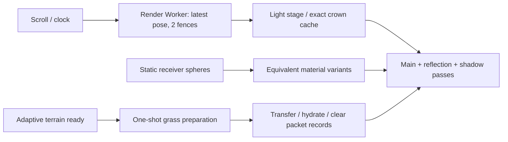

# C7 v646 — шейдинг, подготовка травы и проверенный локальный выпуск

08.11.2026. Рабочая версия: **http://127.0.0.1:3212/c7/**. Production export, runtime-v646. Без публикации, commit, push, агентов и видимых окон. v641/v645 и чужой tracked diff сохранены; проверка — `verification.json`.

## Результат и открытая цель

На общем fixed360 стенде широкий пролёт: **v641 33.38 → v645 39.93 → v646 41.40 завершения GPU-команд/с**. Общий прирост **24.01%**, этот проход к v645 **3.68%**. Это не физически показанный FPS. Цель +75–100% **не достигнута**; требуемый диапазон в этом же тесте 58.42–66.76/с. Нужны ещё 41.1–61.3% к текущей пропускной способности. Это не объявлено пределом оборудования или математической невозможностью.

Приняты только подтверждённые изменения: точная специализация нулевых spot-вкладов на статических receiver bounds; точный ограниченный кеш солнечных полей крон; одноразовая параллельная подготовка травы на достаточно обеспеченных desktop; освобождение потреблённого пакета. Детализация, растительность, разрешение, тени/отражения, камера и тайминг сохранены. Более быстрый flat/unlit вариант не принят.

## Согласование 31,35 и 41,90

Исторические 41,90 — rAF-вход, 2с motion warmup +10с измерения, непостоянный набор принятых поз. Архитектурные31,35 — ровно180 принятых/завершённых поз, тот же путь .05→.87→.05, clock10+i/60, но другая плотность поз/шаг солнечной сетки и только2с прогрева. CSS2560×900/DPR1,5/buffer3840×1350 совпадают; hash runtime-v645 world.js совпадает.

Свежая калибровка неизменной v645: rAF40,52/40,63 (2с/полные360поз прогрева), timer39,28/39,35. Разница механизма около3%, прогрева менее1%; **это не объясняет падение до31,35**. Причина остаточного исторического расхождения не установлена. Фоновая GPU-нагрузка/температура не реконструированы; выдуманного объяснения нет. Проценты старых сценариев сюда не перенесены.

Общий новый протокол: Apple M3 Pro11CPU/18GiB, macOS26.7.1, Chrome156.0.8078.80/ANGLE Metal, AC100%, thermal warnings нет. GPU температура/частота недоступны. Свежий headless process на прогон; no CPU/network throttling для рендера; production static export;360поз shader/scene warmup,120мс settle, затем360 одинаковых принятых и завершённых поз, фиксированные clock/solar/seed. Три пары/тройки, порядок чередуется. Max2 in-flight, clientWaitSync(...,0,0), poll4мс; нет gl.finish и синхронного ожидания каждого кадра. Не сбрасывался системный/драйверный shader cache.

| CSS | DPR | Drawing buffer |
|---|---:|---|
| 390×844 | 1 | 390×844 |
| 1440×900 | 1,5 | 2160×1350 |
| 2560×900 | 1,5 | 3840×1350 |

390 — эмуляция на том же Mac. Fixed/timer вход не ограничен rAF60: пустой renderer дал59,91/с черезrAF и110,31/с черезtimer. Показатель около60 нельзя автоматически считать пределомGPU/дисплея. Presentation cadence и физические dropped frames здесь не измерены. p50/p95 ниже — интервалы **отправки**, CPU — enqueue/JS, завершение fence — наблюдение завершения команд, не показ кадра. Доля >25,2мс — превышение выбранного40Hz бюджета с допуском, не фактические пропуски экрана. Отсутствие long tasks не исключает CPU bottleneck; CPU/GPU не складываются.

## Фактические программы и частота работы

Исходники `lab/c7-scene/`; подключение `app/c7/scene/{early-worker,render-worker,shared-world}`, prefetch `app/c7/page.tsx`; сборка `scripts/c7-package-world.mjs`. React19.1.1/Next15.5.29 уже используются; Three0.186.0/WebGL2, безR3F. `diagnostics.version=v613-deferred-image-readiness` — историческая метка функции, **не идентификатор выпуска**: URL/package/SHA подтверждают646.

| Подсистема | Реальная работа | Частота/доказательство |
|---|---|---|
| Холмы: materials.js, fused-ground-sky.js, sky-horizon.js | PBR direct/indirect, sheen, bump/поле цвета, отдельный thin canopy; общие horizon texels surface+canopy; tree atlas/PCF fallback | Нормаль/цвет/horizon/BRDF на fragment; shadow matrices на vertex; поля статичны, направления/PMREM меняются на solar-grid256 |
| Листья: trees.js | native PBR/IBL/PCF + HG/пигмент/Beer–Lambert ellipsoid, finite solar disk через3×3 поле | alpha-test/clipping сохранены; canopy geometry per-object, radiance/directions per-light-stage, HG/path per-fragment; windStrength исходно0 |
| Terrain visibility крон | 13крон ×9лучей на уникальное направление;4light clearance rays на крону через существующий кеш | Последнее солнечное поле прежде забывалось при любом новом направлении. Новый кеш возвращает ровно прежние Float32 bytes, не интерполяцию |
| Native тени | 4directional maps и3статических rear spot maps; frozen rear maps уже были в645 | Изменения интенсивности не требуют нового rear depth. Все реальные caster/PCF/размеры сохранены |
| Отражение/PMREM/atlas | Те же дополнительные проходы и те же объекты | Принятое изменение не снижает частоту отражений, размер targets или число сэмплов |

`shaders/` —25generatedGLSL программ645; `final-shaders/` — программы текущего646, active uniforms/attributes и проверка spatial variants. Это строки после Three, не nativeISA. WEBGL_debug_shaders возвращает пустые translated strings; точного MSL/инструкций нет. LOW/MEDIUM/HIGH_FLOAT на этом backend дают23бит, поэтому экономия черезmediump не предполагалась.

**Исправление прошлого архитектурного вывода:** прежний flat diagnostic убирал alpha-test и reflection clipping; он менял покрытие пикселей. Неизменный vertex source тоже не сохраняет GPU vertex work: linker удаляет неиспользуемые varyings. Поэтому прежние47,7% «чистого шейдинга» и соответствующий расчёт Амдала недействительны. Новый flat-coverage сохраняет маски/clip/depth, но всё ещё лишь диагностический потолок, не точная доля fragment service time. Поправка добавлена в ADR645, исторические данные сохранены.

## Внедрённые изменения

1. **spot-receivers.js + world.js.** Доказуемо непересекающиеся с каждым из3rear spot cones/ranges мировые bounding spheres получают вариант исходного материала без нулевой spot-lobe. Учтены shader wind bounds и запас0,1м.3418из3478mesh receivers:249terrain tiles,20tree meshes,3071near grass,78far grass.23material aliases; ground/leaf main+reflection не имеют активных spot uniforms/spot matrix varying, shader programs25→33. Сохраняется исходный opaque sort через исходные material IDs: его изменение сначала давало заметные edge pixels и было исправлено. Свойства материалов синхронизируются один раз на pass; живые изменения и version invalidation сохраняются. При изменении rear rig — автоматический возврат исходных материалов; перед изменением статической геометрии/иерархии редактор вызывает `world.spotReceivers.invalidate()`. Только desktop Chromium; другие профили сохраняют предыдущий shader path.
2. **trees.js.** Per-crown Map до512точных полей, ключ из исходных direction/radius; копирование в прежний texture upload buffer. Это ускоряет обратную/повторную прокрутку, не первый расчёт нового направления. Нет baking динамического света. Максимум6656entries,958464B Float32 data плюс JS metadata; на прогретом маршруте2353entries/338832B. `invalidateTerrainLighting()` и dispose очищают кеш. Цвет, field precision, texture count и семплирование прежние.
3. **grass-packet.js / grass-prep-entry.js / adaptive-terrain.js / grass.js / worker-entry.js / world.js.** CPU generator работает одновременно с основной подготовкой сцены в одном дополнительном одноразовом Worker. Тот же seed/geometry/interpolation; input sampler клонируется один раз,53 478 392B output buffers передаются с ownership transfer. Основной renderer остаётся единственным владельцем render loop/GPU. Helper только при mobile=false, deviceMemory≥8 и hardwareConcurrency≥6; missing capability/error/timeout/abort дают serial fallback/terminate. Не требует SharedArrayBuffer/COOP/COEP. На телефонах дополнительного heap нет.
4. **Освобождение результата helper.** Fulfilled promises удерживали packet.records; после TF подготовки старые vec3 normals уже заменены vec4, но оставались в пакете. Records очищаются сразу после hydration, нужные массивы остаются у geometry/patches. Подтверждённое backing storage165,23→151,32MiB против151,29у645,5case/back cycles без роста; heap также уменьшился. Это V8 backing storage, не GPU VRAM/RSS. Временные sampler/output bytes около75MB плюс JS overhead всё ещё существуют во время desktop build; пик RSS не измерен.

Порядок данных:



Материальные варианты создаются до compileAsync; отражённый и основной проходы используют те же материалы. Дополнительные программы — измеренный startup tradeoff; helper перекрывает его на данном desktop. Визуальные компромиссы не приняты.

## Эксперименты и отказы

Однофакторные screen между контролями, fixed360; численные ряды в JSON. Это ранжирование, не суммы независимых затрат.

| Изменение | Наблюдение / решение |
|---|---|
| Tree NoL native-shadow gate |39,21 против38,98–39,15; нет сильного эффекта, не принят |
| Tree/ground flat с alpha+clip |44,90/50,36, вместе63,42 против38,60–39,46; изображение меняется, не product gain; в первом combined bark был пропущен, строка помечена |
| Удалить tree/ground indirect |40,05/41,06 против≈39; меняет свет, только диагностический потолок |
| Ground noise/bump/sheen, direct PBR/canopy |39,29/40,08/39,71/41,68/39,84; эффект распределён, нельзя складывать |
| Tree shadow coordinates перенести воfragment | Исправленный одинаковый PCF:39,02/39,33/39,40 против39,41–39,73; NO_GO. Первый stock-PCF вариант confounded и исключён |
| Ground horizon 2DArray→3D interpolation |40,08 против39,67–39,80; max2/255 и слабый gain — отклонён. InitialGL1282 из-за sharedSource исключён |
| Neutral material constants / full immutable scalars | Менее1% / около2% в screen; убедительного устойчивого эффекта нет, не внедрено |
| Spatial spots |3pairs≈39,45→40,95, затем интегрированный финальный стенд ниже. Сохранение порядка устранило исходный max81edge defect |
| Static matrices | CPU8,5→7,9мс, throughput41,34 против41,14–41,32; GPU не ускорился, не внедрено |
| Zero thin-lamina fallback |41,0 против41,01–41,04; не внедрено |
| Frozen wind branch/constant | Слабый эффект на фоне сдвига контроля40,11→41,03; не подтверждён, исходное поведение сохранено |
| Группировка spot variants внутри исходной material группы | CPU≈−0,2мс,41,02 против41,10–41,12; NO_GO |
| Удалить ACES / sRGB / оба |41,43/41,54/41,87 против41,20–41,42; даже полное удаление не даёт крупного резерва. LUT не обоснован |
| Compact grass spot coordinate prolog | Linker показывает оставшиеся uniform bindings, но удаление3матриц41,28 против41,17–41,46; не принят. Active uniform не равен доказанной ALU-стоимости |

Старые неудачные MRT/batching/ветер/WASM/WebGPU не повторялись без новой причины. Новая3Dfield проверка обусловлена тем, что старый hook не попадал в fused c7HorizonPair; raw stock-PCF контроль был исправлен. Никакие выключенные эффекты не остались в пользовательском пакете.

## Итоговые сопоставимые показатели

Медиана [min–max] трёх прогонов. Fixed360 во всех версиях принимает/завершает ровно360поз. Полные samples/completed timestamps в финальных wide JSON.

| Сценарий | Версия | Завершений/с | p50 отправки, мс | p95 отправки, мс | >25,2мс | CPU p50, мс |
|---|---|---:|---:|---:|---:|---:|
| wide | v641 | 33.38 [33.30–33.38] | 30.6 | 35.9 [35.5–36.3] | 90.81% | 8.9 |
| wide | v645 | 39.93 [39.87–40.06] | 25.2 | 31.3 [31.2–31.8] | 49.58% | 8.6 |
| wide | v646 | 41.40 [41.07–41.41] | 24.7 | 30.8 [30.4–30.8] | 41.78% | 8.4 |
| transition | v645 | 49.46 [49.29–50.06] | 19.0 | 29.5 [29.5–29.7] | 15.32% | 6.8 |
| transition | v646 | 52.10 [52.04–52.72] | 18.5 | 27.6 [27.3–27.9] | 9.47% | 7.3 |
| mobile | v645 | 88.03 [86.05–88.18] | 11.0 | 15.5 [15.3–15.7] | 0.00% | 5.2 |
| mobile | v646 | 96.21 [95.56–97.60] | 10.4 | 11.7 [11.7–12.0] | 0.00% | 4.7 |

Mobile shader/extra worker выключены; ускорение там происходит в CPU расчётах освещения. Эти96/с — uncapped Mac measurement, **не96FPS телефона**. Transition имеет небольшой рост CPU из-за материализации вариантов, при этом GPU throughput выигрывает.

| Реальный /c7/, DOM + обратимые анимации | v645, /с | v646, /с | p95 отправки, мс |
|---|---:|---:|---:|
| 24 с вниз/вверх | 44.61 [44.61–44.85] | 46.55 [46.53–46.60] | 46.9 → 42.8 |
| 6 с вниз/вверх | 40.79 [39.86–40.82] | 41.54 [41.37–41.74] | 50.1 → 48.3 |

Для прогретых transition/mobile/actual DOM после исправления ownership используются сохранённые данные предыдущего проверенного checkpoint: эти измерители создают мир без helper, изменённая ветка grassResult там не выполняется. Побайтовое доказательство единственного изменения — `ownership-only-proof.json`. Текущий пакет отдельно проходит fresh wide/загрузку/память/visual/fault/UI. Повтор всего аудита ради очистки записи не выдаётся за необходимый. First-scroll без warmup проверяется отдельно.

Отдельный первый6с scroll сразу после `.is-ready`, без qa-config/прогрева; **инструментирован реальный native worker каждой версии**, helper включается штатным условием. Три пары, desktop2560; routed HTTP cache отличается от primary load и используется только для одинакового first-scroll сравнения. Main long tasks0; не INP/physicalFPS.

| Первый проход | Завершений/с | p95 отправки, мс | CPU max, мс |
|---|---:|---:|---:|
| v645 | 40.00 [39.91–40.19] | 50.5 | 27.0 |
| v646 | 40.99 [40.67–41.63] | 48.2 | 20.1 |

`gpu-ranges.json`: 24.66 [22.77–25.91] → 23.13 [22.28–26.02]мс (median/range разных6поз, **не3приёмочныепары**). Поддержанный EXT_disjoint_timer_query_webgl2,6фиксированныхпоз, каждый диапазон дренируется асинхронно перед следующим, disjoint0/GL0. Нет принудительного ожидания каждого продуктового кадра. Это диагностическое время диапазона GPU-команд, включая возможные интервалы ожидания CPU/других контекстов; не exclusive shader service и не display FPS. Старые перекрывающиеся/summed queries не использованы для долей затрат. Источник/сырыеCPU/wall/GPU значения сохранены.

## Загрузка

Секунды до штатного `.is-ready` (первый подготовленный/submitted3D, не LCP/не physical presentation). Три AB/BA/AB cold/warm прогона; cold очищает HTTP cache и создаёт новый context/process, driver/OS cache не сбрасывался. Сервер одинаковый: Brotli/gzip текстов, существующие lossless binary transports, ETag/cache.

| Профиль | HTTP cache | v645, с | v646, с | Изменение времени |
|---|---|---:|---:|---:|
| loopback / 1440 | cold | 2.568 [2.555–2.580] | 2.276 [2.272–2.333] | -11.36% |
| loopback / 1440 | warm | 2.478 [2.442–2.567] | 2.147 [2.135–2.173] | -13.37% |
| 4Mbps+100ms / 390 emulation | cold | 5.173 [5.152–5.184] | 5.179 [5.169–5.190] | +0.12% |
| 4Mbps+100ms / 390 emulation | warm | 1.850 [1.847–1.908] | 1.857 [1.848–1.858] | +0.36% |
| 4Mbps+100ms / 1440 | cold | 6.812 [6.806–6.851] | 6.583 [6.583–6.610] | -3.36% |
| 4Mbps+100ms / 1440 | warm | 2.554 [2.546–2.578] | 2.295 [2.268–2.321] | -10.13% |

Mobile ускорения загрузки нет. Payload почти тот же: новые JS/entry добавляют несколькоKB, исходные изображения/бинарные поля побайтно те же. Это CPU overlap, не сокращение передачи. Полный runtime с альтернативными транспортами — не первая передача посетителю.

Критический путь: HTML→early renderer worker/world+startup I/O→terrain decode/adaptive→trees/textures и parallel grass→hydration/static TF→shader compile→first scene→поздние horizon fields и прежний800msfade→полностью установившееся освещение.

Отдельный cold diagnostic через обычный HTTP, без route/cache interception, записывает initial и полностью освещённый GPU-complete кадр (`readiness-diagnostic.json`). Разделяет загрузку и fade, **не маскирует поздние поля ранним скрытием loader**. Предыдущая routed проба меняла cache/coalescing и сохранена отдельно как несопоставимая с основным профилем. Диагностические скрипты не попали в release. Один прогон/профиль, не статистическая оценка загрузки:

| CSS / версия | Ready submitted, с | Ready GPU complete, с | Освещение установилось, GPU complete, с |
|---|---:|---:|---:|
| 1440 / v645 | 2.510 | 2.563 | 3.414 |
| 1440 / v646 | 2.280 | 2.305 | 3.171 |
| 390 / v645 | 5.166 | 5.182 | 6.662 |
| 390 / v646 | 5.163 | 5.179 | 6.650 |

Для390 действует4Мбит/с+100мс;1440—loopback. До4с **полного мобильного состояния** не достигнуто: окончательные поля/800мсfade отстают от первого полезного состояния. Ускорением loader это не замаскировано.

## Визуал, поведение и память

- Chrome42fixed RGBA кадра/3widths против645, ещё42против641: max≤1/255, каналов сdiff>1 нет, GL/errors0. Включены dawn/day/late/sunset, near/far, вода/отражение, прямой/обратный путь. Карты различий и reference/candidate PNG сохранены, локальные области не скрыты средним MAE.
- Live control14кадров: roughness/цвет terrain, leaf anisotropy/canopy strength, изменение rear cone/position с auto-deopt, сброс terrain lighting cache — max≤1. Проверяется переход `spotsEnabled:true→false` в тот же кадр.
- WebKit22/22точных hashes: основной поток, не Safari/iOS. Firefox functional pass, строгая повторяемость пикселей остаётсяOPEN.
- Current Chrome resize/orientation,5+5client case/back cycles, helper fault fallback, early departure, context loss/restore exact frame, no-WebGL/save-data fallback, форма/mailto/consent, replay up, legal pages/Extra Meat: результаты в QA status и отдельных JSON. Нет новых missing resources/console errors.
- Реальное headless переключение вкладки оставляет document.visibilityState=visible: native hidden/recovery NOT_RUN, не выдано заPASS. Физические устройства/слабыйGPU/nativeSafari/VoiceOver/TalkBack/displayFPS/fieldINP/VRAM и peakRSS NOT_RUN. Системные разрешения/настройки не менялись.

## Целостность, откат и воспроизведение

Пакет `artifacts/c7-preview-2026-11-08-v646-local`: **111файл / 22475701B**, 90build hashes/48bundled sources. Реально подключён646 вprefetch, early worker, render worker, main fallback; marker646 исключает stale early worker. Исходные645/641 runtime и portable packages проверены поSHA; HEAD/tracked diff прежние. Source backup `backups/c7-v646-start-2026-11-08/`,20изменённых/новых code paths вverification; прежние checkpoints вresearch/evidence. Packager отказывается писать в защищённые641/645. Никаких secret/env/баз в пакет не добавлено.

Adaptive serializer не меняет вычислительные инструкции исходного интерполятора: удаление только нового метода восстанавливает исходный source побайтно; horizon payloads неизменны. Metadata rebinding имеет отдельное доказательство. Startup data реально rebaked к тому же rawSHA; mobile assets реально пересобраны к тем же pixels/bytes. Hash-проверки не отключались.

Для повторения тройного benchmark нужно отдельно запустить неизменяемую641на3191 и645на3210. Сейчас оставлены current3212 и прежняя645/3210; временные profiling-серверы остановлены. Команды запуска выполнять только если соответствующий порт свободен:

```sh
node scripts/c7-perf-server.mjs artifacts/c7-preview-2026-11-07-v641-local 3191
node scripts/c7-perf-server.mjs artifacts/c7-preview-2026-11-08-v645-local 3210
```

Сборка/проверка:

```sh
node scripts/c7-package-world.mjs
node scripts/c7-build-local.mjs
node scripts/c7-package-preview.mjs artifacts/NEW-UNUSED-DIRECTORY
node scripts/c7-perf-server.mjs artifacts/c7-preview-2026-11-08-v646-local 3212
QA_MODE=runtime node research/c7-v646-shading-2026-11-08/pixels.mjs
node research/c7-v646-shading-2026-11-08/final-qa.mjs
node research/c7-v646-shading-2026-11-08/verify.mjs
```

Исследование — `research/c7-v646-shading-2026-11-08/`; данные — `evidence/c7-v646-shading-2026-11-08/`. Архив pre-ownership имеет отдельный source/provenance; не подменяет текущие startup/ownership gates. Skills: установленные threejs-performance, threejs-shaders, threejs-debug-profiler (+debug-playbook), web-perf; asset-pipeline проверен применительно к lossless сохранению ресурсов, GLB/R3F здесь нет. Новые skills/tools/dependencies не устанавливались, версии движка не менялись. MCP DevTools недоступен; применены имеющиеся Playwright/CDP/nativeChrome, GPU queries/fences, исходникиr186, V8 heap и HTTP receipts.

## Что мешает цели и следующий приоритет

Требуемая общая экономия ещё примерно7–9мс эквивалентного интервала при нынешнем24мс широком пути; она не получена. CPU уменьшение само по себе широкую сцену не ускоряет: matrix freeze и подготовка Worker это подтвердили. Основная стоимость остаётся у полноценного shaded изображения и повторных GPU проходов; выключение источника/эффекта — не бесплатная оптимизация.

Крупный следующий кандидат — другое представление terrain/tree visibility для directional проходов и повторного отражённого вида с сохранением оригинального PCF/динамики; сначала нужен маленький per-pass prototype с pixel/динамическими gates и измерением полного кадра. Это гипотеза, не обещание75%. Просто Rust/WASM/перенос основного потока/WebGPU без нового доказательства не вернут требуемые7–9мс GPU. Снижение DPR, густоты, числа теней, разрешения отражения, unlit/baking изменённого света не принято. Точное художественное совпадение image3 и G04/G07/внешняя приёмка остаются открытыми;10/10 не заявлено.
